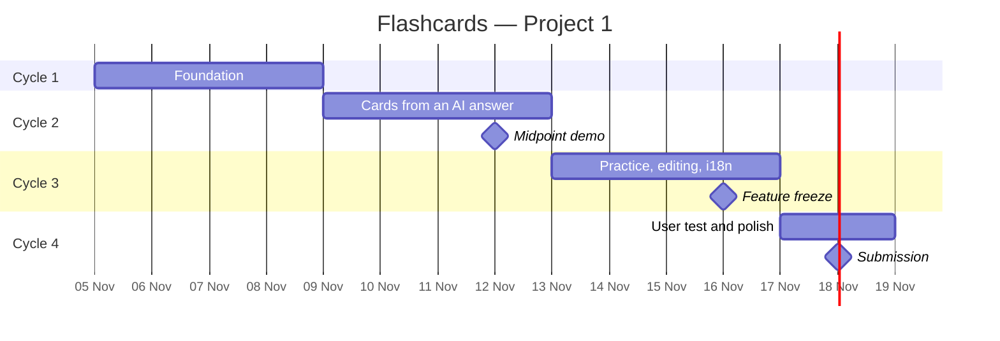

# Timeline

Project 1 runs from **5 November to 18 November 2026**. Four cycles, each ending with something
that works. Every cycle is a GitHub milestone, and every issue belongs to one.

## Cycle 1 — Foundation · 5–8 November

A real but empty app that all three of us can work in.

| Role | Issues |
| --- | --- |
| Team | [#1](../../../issues/1) docs, backlog, timeline, conventions |
| Frontend | [#2](../../../issues/2) scaffold · [#4](../../../issues/4) design system · [#5](../../../issues/5) app shell · [#6](../../../issues/6) i18n foundation |
| Backend | [#8](../../../issues/8) auth and protected routes |
| Database | [#3](../../../issues/3) Supabase setup · [#7](../../../issues/7) schema and RLS · [#9](../../../issues/9) CI workflow |

**Done when:** the app builds, a user can sign in, the two tables exist with policies, and both
languages switch.

## Cycle 2 — Cards from an AI answer · 9–12 November

The main user journey, end to end. This is the cycle the midpoint demo comes from.

| Role | Issues |
| --- | --- |
| Frontend | [#10](../../../issues/10) prompt page · [#11](../../../issues/11) prompt variants · [#12](../../../issues/12) text parser · [#13](../../../issues/13) JSON parser · [#14](../../../issues/14) paste screen · [#19](../../../issues/19) deck list |
| Backend | [#15](../../../issues/15) validation · [#16](../../../issues/16) create deck · [#17](../../../issues/17) deck list, rename, delete |
| Database | [#18](../../../issues/18) queries with counts · [#20](../../../issues/20) RLS checks |
| Team | [#21](../../../issues/21) midpoint walkthrough |

**Milestone, 12 November:** demonstrate one feature that goes interface → backend → database.
Paste an answer, save a deck, see it in the list.

## Cycle 3 — Practice, editing and two languages · 13–16 November

Everything the contact asked for is now in the product.

| Role | Issues |
| --- | --- |
| Frontend | [#22](../../../issues/22) practice session · [#23](../../../issues/23) shuffle · [#24](../../../issues/24) reshuffle · [#25](../../../issues/25) round summary · [#26](../../../issues/26) card editor · [#30](../../../issues/30) full i18n |
| Backend | [#27](../../../issues/27) card update and delete · [#29](../../../issues/29) practice rating · [#31](../../../issues/31) size limits and rate limiting |
| Database | [#28](../../../issues/28) practice results |

**Feature freeze, 16 November.** After this point only fixes, polish and the improvement that
comes out of the feedback session.

## Cycle 4 — User test, polish and submission · 17–18 November

| Role | Issues |
| --- | --- |
| Frontend | [#32](../../../issues/32) accessibility and contrast pass |
| Database | [#33](../../../issues/33) deploy to Vercel · [#34](../../../issues/34) journey checklist |
| Team | [#35](../../../issues/35) recorded feedback session · [#36](../../../issues/36) the improvement from it · [#37](../../../issues/37) submission |

**Deadline, 18 November:** repository, setup instructions, test results, feedback summary and the
restricted recording link.

## Load and risks

- **Frontend carries the most issues** (17 of 37). If Cycle 2 slips, [#13](../../../issues/13)
  (JSON parser) and [#24](../../../issues/24) (reshuffle) are the two `prio: should` items that
  move to Cycle 4 or get picked up by whoever has room.
- **The parser is the risk in the product.** Real AI answers are messy. [#12](../../../issues/12)
  is tested against at least five real answers from two different tools before the paste screen
  is called done.
- **Deployment before the user test, not after.** [#33](../../../issues/33) has to be finished on
  16 November so the contact tests the deployed app, not a laptop.
- **The recording cannot be postponed.** [#35](../../../issues/35) is booked with the contact
  during Cycle 3, not on 18 November.

## After Project 1

Project 2 starts on 19 November with rotated roles (frontend → backend → database → frontend).
Final presentation is on 10 December, with one of the two apps chosen and improved in the
3–9 December window.
